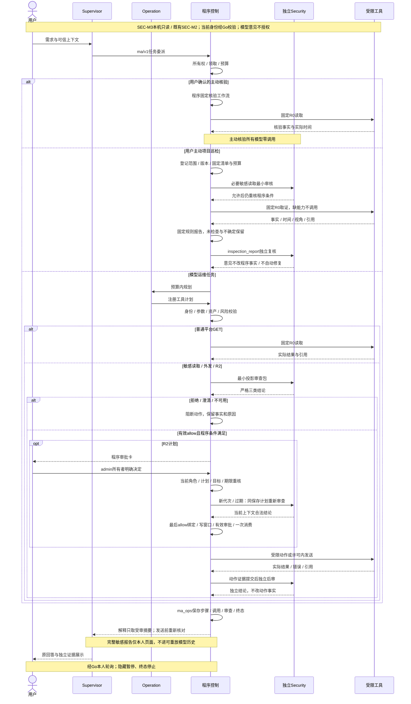

---
tags:
  - 源网智联
  - 第二版
  - 多智能体
  - 架构设计
status: 现行
scope: 第二版-多智能体
updated: 2026-10-14
---

# 02 · 任务协议与接口契约

> 2026-10-14当前：SEC-M4本机限定签收及r6追加准入通过；MA-C32～C35和最终文档门槛已完成，MA-M4及联合阶段四在声明范围正式技术签收。服务器r6/v5、恢复维护修订3；本机唯一批准动作保留，写窗口关闭，生产仅登记R0。

> 固定ma/v1、类型、API及兼容行为；对应MA-T02、MA-T04～MA-T06。

## 一、TaskEnvelope

所有新Agent间任务消息带 `protocol=ma/v1`；未知版本返回 `unsupported_protocol`，不降级解释。

```json
{
  "protocol": "ma/v1",
  "task_id": "11111111-1111-4111-8111-111111111111",
  "trace_id": "22222222-2222-4222-8222-222222222222",
  "idempotency_key": "33333333-3333-4333-8333-333333333333",
  "session_id": "44444444-4444-4444-8444-444444444444",
  "parent_turn_id": null,
  "actor": {"user_id": 1, "role": "operator"},
  "intent": "query_device_status",
  "user_request": "查看第二台设备现在的状态",
  "targets": [],
  "constraints": {"max_risk_class": "R0", "timeout_sec": 300},
  "created_at": "2026-10-12T10:00:00+08:00"
}
```

以上UUID和用户ID是文档样例，不对应真实资产或已创建任务。

- task、trace、幂等键和会话为UUID；user_id及parent_turn_id为正整数BIGINT语义。
- parent_turn_id可为空，在聊天轮次实际保存后由受信服务绑定；不得随意关联别人的轮次。
- targets使用在册asset_id；“第二台”先按平台 `id ASC`台账解析，不凭模型固定为某个设备ID。
- 允许尚未解析的语义目标进入只读规划，解析不唯一时不得启动取证，返回澄清信息。
- 风险上限、超时、actor、task/trace标识由程序赋值，模型只提出intent和目标语义；首两个里程碑上限R0。
- 输入采用严格schema，拒绝额外字段、非法枚举、越界参数和任意执行文本。

## 二、可信上下文与消息签名

Go校验用户JWT和用户表后生成签名身份上下文，覆盖用户、当前角色、会话、trace、原请求摘要、时间戳和有效期。Supervisor不改变原声明，并用独立服务签名覆盖完整任务信封。Operation同时校验Go身份签名与Supervisor信封签名，拒绝身份/会话/请求摘要不匹配。

服务token、原JWT及签名材料通过私有HTTP头传递，不进入模型、队列、公共响应或持久化任务正文；数据库只保留归属、请求哈希和签名校验结果。JWT仅在受理任务的内存上下文使用，平台固定GET仍以当前用户JWT走Go原权限检查。

签名采用HMAC-SHA256，规范化JSON键顺序与UTF-8字节；每个信任链路独立密钥，固定受众、key_id和过期校验；签名值使用常量时间比较。完整任务签名覆盖task_id与幂等键，防止修改任务身份。签名技术规格实施时写进源码README，私有值不写笔记。

## 三、ResultEnvelope与工具结果

```json
{
  "protocol": "ma/v1",
  "task_id": "11111111-1111-4111-8111-111111111111",
  "trace_id": "22222222-2222-4222-8222-222222222222",
  "status": "succeeded",
  "steps": [{"step_no": 1, "tool": "platform.get_telemetry", "status": "succeeded", "risk_class": "R0"}],
  "evidence_refs": ["call:55555555-5555-4555-8555-555555555555"],
  "diagnosis": {"hypotheses": [], "recommendations": []},
  "warnings": [],
  "error": null,
  "finished_at": "2026-10-12T10:00:03+08:00"
}
```

steps及程序证据来自Executor，diagnosis来自运维模型，两者来源标记独立。错误结构为 `{code,message,retryable}`，固定错误至少包含 invalid_args、unsupported_protocol、permission_denied、asset_not_found、target_ambiguous、guard_blocked、target_unreachable、timeout、auth_context_lost、execution_uncertain。消息脱敏，retryable不构成自动写重试授权。

## 四、公共接口（MA-M1～M3已实现）

全部经Go JWT入口，沿用 `code/message/data`。任务列表页长默认20、上限100；按created_at与task_id倒序，offset非负。

| 方法与路径 | 功能 |
| --- | --- |
| GET /api/v1/agent/tasks | 本人任务列表；可按session_id/status过滤 |
| GET /api/v1/agent/tasks/:id | 本人任务、步骤、证据和报告 |
| POST /api/v1/agent/tasks/:id/cancel | 本人任务取消；终态幂等返回原结果 |
| POST /api/v1/agent/tasks/:id/approvals/:approval_id/decision | admin本人审批；approve/reject |
| DELETE /api/v1/agent/tasks/:id | 本人任务从任务记录移除（软删除，仅终态）；详情仍可读，重复删除幂等返回 `already_deleted`；非终态409 `task_not_terminal`、跨用户404 |

任务由聊天内部委派创建，不增加可随意提交完整TaskEnvelope的公共创建入口。审批拒绝或批准只来自程序页面动作，不从聊天文本自动解析为批准。跨用户404；无权限403；非法参数400；幂等冲突/错误状态409；容量超限429与Retry-After；依赖故障503。

删除只写 `ma_tasks.deleted_at`/`deleted_by` 并追加一条 `ma_task_events(reason='user_deleted')`，`ma_task_steps`、`ma_tool_calls`、`ma_approvals`、`ma_execution_attempts`、`ma_security_reviews` 等审计表零改动；列表查询过滤 `deleted_at IS NULL`，详情与报告不过滤。

## 五、内部接口（MA-M1～M3实现基线）

- `POST /internal/ma/v1/tasks`：严格信封受理，事务持久化后202；重复同载荷返回已有task_id。
- `GET /internal/ma/v1/tasks`与 `GET /internal/ma/v1/tasks/:id`：服务验证的用户上下文查询。
- `POST /internal/ma/v1/tasks/:id/bind-turn`：受信服务补齐同所有者会话实际轮次，重复相同关联幂等，改关联409。
- `POST /internal/ma/v1/tasks/:id/cancel`及审批decision：由Go代理当前用户决定。
- `DELETE /internal/ma/v1/tasks/:id`：软删除单条终态任务，恒返回200（含 `deleted`/`already_deleted`/`deleted_at`），便于Go代理按200判定成功；非终态409、跨用户404。仅此一处写 `deleted_at`，其他内部接口不变。
- `POST /internal/ma/v1/verifications`：现行核验固定输入，程序GET输出；不启动Planner模型。
- `POST /internal/agent/knowledge/search`：阶段8向Worker提供受限RAG查询，不开放导入。
- `GET /health`：脱敏配置与依赖状态，不能宣称模型真实可用。
- Go侧 `GET /internal/ma/v1/actor`：验证Operation专用服务凭据及当前用户JWT，从用户表取得实时身份/角色，返回限定有效期的签名声明；仅用于程序授权，不提供业务写入。

内部入口拒绝外部代理，固定目标和路径，禁止跳转；接口不开放任意HTTP转发。绑定轮次前由阶段8服务校验归属，Operation不跨库读RAG表。

## 六、聊天、页面和任务时序

聊天输入仍为message及可选session_id；响应兼容新增 `task_cards[]`和response_mode=task_dispatched。原status枚举不塞入queued/executing；answered表示受理答复可展示，不代表任务已成功，卡片status明确显示实际任务状态。

Supervisor受理后最多等待15秒，并受剩余120秒聊天预算限制；短任务完成则汇总。否则持久化任务卡返回，断开聊天不撤销已受理任务。任务请求与聊天保存非跨库事务：任务绑定失败保留task_id及session_id，记录link_pending并重试同一绑定，不创建第二个任务。

前端每2秒查询本人状态，隐藏时暂停，恢复可见立即查询；终态停止，429遵从Retry-After，网络失败保留最后状态并标更新失败。长任务报告在卡片展示，“解释此结果”提交新聊天轮次且引用本人task_id，不覆写原回答。



![[01-项目调研规划与开发建设记录/02-第二版-智能体升级/多智能体协作建设/02-技术选型与架构设计/diagrams/task-sequence.png|任务交接与查询时序]]

图示沿用已实现的安全/巡检分支及既有状态枚举；当前服务器R0、本机关闭演练与只读恢复边界见阶段四交付页。图源：[[01-项目调研规划与开发建设记录/02-第二版-智能体升级/多智能体协作建设/02-技术选型与架构设计/diagrams/task-sequence.mmd|task-sequence.mmd]]。现有BND取证字段由真实委派工具记录适配；本轮待执行不计查询成功，历史任务证据标历史。

## MA-M1本机契约补充（历史）（2026-10-12，阶段二启动前）

> 下列为当次阶段补充；当前路线见总索引，签收历史见[[01-项目调研规划与开发建设记录/02-第二版-智能体升级/多智能体协作建设/01-项目规划与需求/05-规划演进与历史记录]]。

实施补充：未限定筛选条件的序数设备无需主模型过度澄清，委派运维按id ASC读取实际台账。新会话由Go生成UUID。Go签名与信封签名受众独立，450秒；完整信封摘要按接收HTTP JSON计算。ResultEnvelope包含session_id、原轮次、程序calls和时间、实际取证、历史定位字段，未知输出字段拒绝。核验意图在公开卡片显示为设备与查询项目，内部固定流程载荷不作为用户界面文案。待执行15秒直接返回卡片，不额外调用主模型等待回答。

## MA-C10收尾契约补充（2026-10-12）

Retry-After先于正文解析，支持秒数及HTTP日期，错误正文非JSON时也保留等待。轮询等待截止时间用单调时钟保存，隐藏/恢复不能提前越过期限；没有未到期等待时恢复立即查询。HTTP/连接故障保留最后状态，下一成功读取清除错误，终态停止。原生可信事件和分段GET计数作为页面证据，不用模拟事件代偿。

## MA-M2兼容增量（2026-10-12）

公共聊天/任务沿用ma/v1，步骤/调用附可空asset_id及asset_version，报告新增默认空infrastructure_evidence，来源可为infrastructure。旧报告兼容；基础设施证据不计入平台业务取证。资产导入为内部admin入口，执行适配为独立ma-exec/v1短期签名协议，当前Go身份、任务代次/租约/取消/资产版本与一次领取共同约束。路径与参数唯一入口见[[06-代码工作区导航与链接映射/stages-09-ops-agent-README|README]]及阶段二设计，不把后续审批接口写成当前已开放。

## 安全审查规划增量（2026-10-13）

ma/v1、旧任务状态与现有公共审批接口保持；规划新增security_reviews默认空字段和审查事件，不增加公共自由载荷创建。未来ma-review/v1、严格结论、绑定与外发契约由[[01-项目调研规划与开发建设记录/02-第二版-智能体升级/多智能体协作建设/03-程序控制层/06-审查协议、外发与审计]]唯一维护；当前源码尚无安全字段/路由。

详细契约见[[01-项目调研规划与开发建设记录/02-第二版-智能体升级/多智能体协作建设/03-程序控制层/06-审查协议、外发与审计]]；当前状态与原签收范围见总索引和历史页。

## SEC-M2本机建设增量（2026-10-13）

ma/v1保持原任务枚举，ResultEnvelope新增默认空security_reviews、security_events；旧报告缺字段仍兼容。本人任务公开投影不含私有请求/原签名/凭据。受鉴权model-summary只接收空对象，由程序生成最小摘要；check只核对既有审查标识及摘要，不受理自由载荷。跨用户任务404。

最新验收与问题：[[01-项目调研规划与开发建设记录/02-第二版-智能体升级/多智能体协作建设/05-安全审查模型/05-功能开发与阶段交付/02-强制门禁集成/03-SEC-M2测试与交付]]。

## SEC-M3现行契约与规则（2026-10-14）

- 请求新增task_kind=ops/security_inspection，默认ops；巡检仅R0/read_only。本人身份、签名、幂等、预算和取消按既有任务机制。
- 结果新增可选inspection_report：请求/实际范围、逐项状态与原因、引用/版本/时间/视角、发现、假设、缺项、建议与完整性；沿JSON存储，不新增表。
- 程序检查passed/finding/inconclusive/not_checked与模型意见分开；报告复核deny/澄清不改已采集事实，复核依赖不可用failed并保留报告。
- 规则与实现见[[01-项目调研规划与开发建设记录/02-第二版-智能体升级/多智能体协作建设/05-安全审查模型/05-功能开发与阶段交付/03-项目只读巡检/01-方案设计·03-项目只读巡检]]，签收见[[01-项目调研规划与开发建设记录/02-第二版-智能体升级/多智能体协作建设/05-安全审查模型/05-功能开发与阶段交付/03-项目只读巡检/03-SEC-M3测试与交付]]；审查/外发细节仅由审查协议页维护。

## 2026-10-14联合阶段四交付入口

联合第四阶段统一归[[01-项目调研规划与开发建设记录/02-第二版-智能体升级/多智能体协作建设/06-联合发布验收/00-索引·联合发布验收]]，规划/实施/测试/问题集中维护；本地与服务器分层证据沿原SEC/MA编号保存，最终判定见[[01-项目调研规划与开发建设记录/02-第二版-智能体升级/多智能体协作建设/06-联合发布验收/03-联合第四阶段测试与交付]]。

## 阶段四私有绑定与兼容增量

007迁移仅新增私有runtime_context，运行档/策略/许可/配置SHA256在审查、审批及执行前比对，旧NULL及旧绑定不自动提升权限；ma/v1、ma-review/v1、状态与四字段模型意见/六字段服务响应保持。v2数值最小投影仅白名单有限非负值，完整敏感报告供本人页面查看；再次解释重新审查。服务器仅登记R0，恢复只读GET、禁POST/Worker/外发和执行凭据。旧报告缺少新增分区仍可读，上文“尚无”仅为原设计时点历史。

## 相关笔记

- 上游：[[01-项目调研规划与开发建设记录/02-第二版-智能体升级/多智能体协作建设/02-技术选型与架构设计/01-总体架构与智能体职责]]
- 下一章：[[01-项目调研规划与开发建设记录/02-第二版-智能体升级/多智能体协作建设/03-程序控制层/03-任务状态、队列与故障恢复]]
- 需求：[[01-项目调研规划与开发建设记录/02-第二版-智能体升级/多智能体协作建设/01-项目规划与需求/04-非功能需求、边界与成功标准]]
