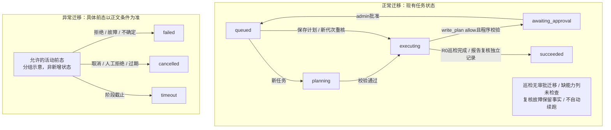

---
tags:
  - 源网智联
  - 第二版
  - 多智能体
  - 架构设计
status: 现行
scope: 第二版-多智能体
updated: 2026-10-14
---

# 03 · 任务状态、队列与故障恢复

> 2026-10-14当前：SEC-M4本机限定签收及r6追加准入通过；MA-C32～C35和最终文档门槛已完成，MA-M4及联合阶段四在声明范围正式技术签收。服务器r6/v5、恢复维护修订3；本机唯一批准动作保留，写窗口关闭，生产仅登记R0。

> 定义业务状态、事务投递、执行代次和中断处理；对应MA-F05、MA-NFR04～MA-NFR05。

## 一、唯一状态枚举

| 状态 | 含义 | 主要后继 |
| --- | --- | --- |
| queued | 已持久化，待运行；可含已批准计划 | planning/executing/cancelled/timeout/failed |
| planning | 模型计划或程序核验规划 | executing/awaiting_approval/failed/cancelled/timeout |
| awaiting_approval | R2步骤等待人类决定 | queued/cancelled/failed |
| executing | 受控取证或动作执行，R2计划先等待审批 | awaiting_approval/succeeded/failed/cancelled/timeout |
| succeeded | 必要步骤完成且证据保存 | 终态 |
| failed | 规划、闸门、工具或不确定结果失败 | 终态 |
| cancelled | 放弃后续步骤，保留已执行部分 | 终态 |
| timeout | 阶段截止，保留已执行部分 | 终态 |

步骤状态使用pending、running、succeeded、failed、skipped、cancelled、timeout。含失败的必要步骤不能整任务succeeded；可选步骤失败记录warnings及不完整证据。回退另存ma_rollbacks，不新增rolled_back任务终态。

![[01-项目调研规划与开发建设记录/02-第二版-智能体升级/多智能体协作建设/02-技术选型与架构设计/diagrams/task-state.png|任务状态规划]]

图示沿用已实现的安全/巡检分支及既有状态枚举；当前服务器R0、本机关闭演练与只读恢复边界见阶段四交付页。图源：[[01-项目调研规划与开发建设记录/02-第二版-智能体升级/多智能体协作建设/02-技术选型与架构设计/diagrams/task-state.mmd|task-state.mmd]]。图中“允许的活动前态”为异常迁移分组示意，不是新增枚举；取消、失败及超时从允许前态进入，具体条件以表格和正文为准。审批等待的30分钟过期进入cancelled，不使用执行阶段timeout。已批准计划重新排队后直接执行已绑定步骤，不再次让模型改写批准参数。

## 二、可靠投递与通知

任务、request_hash及outbox行在ma_ops同事务写入，成功后返回受理。后台投递器从outbox读取task_id，XADD到 `ma:tasks`，成功标记投递；崩溃可能重复XADD，由数据库防重，不宣称exactly-once。

Redis消费组使用XREADGROUP读取，完成持久化处理后XACK；定期检查XPENDING/XAUTOCLAIM处理失联消费者。队列只含task_id及协议版本，进度缓存可丢弃，真实历史从ma_ops查询。

数据库不可用不受理；Redis不可用返回503停止新受理，已写但未投递的outbox保留待恢复。事务提交后响应丢失，客户端同幂等键重试读取原任务。使用现有Redis7.4兼容命令，不引入Redis8新命令。

> [Redis XREADGROUP官方说明](https://redis.io/docs/latest/commands/xreadgroup/)说明消费组维护未确认消息；[XACK说明](https://redis.io/docs/latest/commands/xack/)说明确认清理PEL。应用仍须自己实现业务幂等和故障恢复。

## 三、幂等、领取与租约

唯一约束 `(user_id,idempotency_key)`；request_hash对规范化业务载荷计算，排除task_id、重试生成的时间、签名与trace差异，包含会话、intent、targets、constraints和原请求摘要。同键改载荷409，不调用任何工具。Supervisor在同一次委派的内部重试中复用幂等键；用户另发一条同文消息默认属于新请求，不声称现行聊天接口已具备跨HTTP重试幂等。

Worker以数据库条件更新从queued领取，将execution_epoch递增并记录worker_id、lease_until。Redis租约只辅助并发和心跳，数据库保存可核对的执行代次。每个状态/证据写入检查当前epoch和允许前态，旧Worker不能覆盖新记录。

默认租约50秒、10秒续期，任务300秒和工具15秒另计。工具前再次核验领取所有权；工具结果写入失败立即停止后续步骤。写步骤需要数据库一次性消费审批和执行尝试记录，失去租约不得继续调度。

## 四、恢复与认证上下文

阶段9首期单进程API/Worker持有临时用户JWT及签名上下文，队列/数据库不保存这些材料。聊天连接断开后只读任务可在授权有效期和预算内继续。

- 通知重复或消费者失联但认证上下文仍在：未开始任务可重新投递，由数据库决定唯一领取。
- 服务进程真正重启且认证上下文丢失：未开始任务也不能凭用户ID继续读取，转failed/auth_context_lost；用户重新提交新任务取得新认证，不复活原终态。
- executing任务失联：标failed/worker_interrupted；超过阶段截止标timeout，保存现有证据，不能自动继续写步骤。
- awaiting_approval可持久恢复；审批由新的用户JWT操作注入新认证，必须重新验证角色、资产、计划和预算。
- 已执行动作但结果未落库：标failed/execution_uncertain；人工核对目标状态，不自动重试、不声称未执行。

“未开始任务可重投”有有效认证上下文前提，不以持久化承诺掩盖凭据保护和恢复限制。后续多进程/横向Worker须先单独设计可撤销委托授权，不在本期隐式加入。

## 五、错误策略与取消

R0工具网络失败可在尚未超时且配额允许时重试一次，重试也计入16次工具预算，保留两次调用记录。默认必要步骤失败abort；可选步骤可continue，但不得将不完整数据推为无异常。

R2永不自动重试。已批准步骤的参数、目标或策略变化使审批失效，需新审批。取消设置cancel_requested，由执行器在每一步前读取；若已发出动作先核对结果再终止后续，cancelled不等于已回滚。

## 六、会话与并发

用户1个活动任务、全局2个运行槽及20个等待容量以数据库原子检查/锁约束；不能先查询再无锁插入。等待审批释放运行槽但仍占用户名额。非法身份、依赖故障和配额失败不创建虚假成功记录。

会话删除通过运维服务原子预留删除屏障，检查无活动任务后才删RAG会话；同会话新任务检查屏障，避免“先查无任务再删除”的竞态。删除失败释放屏障，成功保留已删会话标识；终态审计逻辑关联可保留，不跨库级联。

## MA-M1本机契约补充（历史）（2026-10-12，阶段二启动前）

> 下列为当次阶段补充；当前路线见总索引，签收历史见[[01-项目调研规划与开发建设记录/02-第二版-智能体升级/多智能体协作建设/01-项目规划与需求/05-规划演进与历史记录]]。

实施补充：本机运行库ma_ops与专用账号，测试与验收专库分离；启动排队auth_context_lost、运行中断worker_interrupted/timeout；单进程数据库会话锁约束。每次网络重试占调用预算，按最后attempt判步骤成功但保留全部证据。轮次关联从实际会话历史修复，取消等待导致未保存轮次时保留本人未关联任务，不凭空补造轮次。

## Redis消息拒绝补充（2026-10-12）

Stream仅接受protocol=ma/v1与task_id两个字段，拒绝额外字段、未知版本及非法UUID；不存在的任务通知确认后丢弃，避免孤儿通知干扰后续任务。数据库故障不当作不存在而确认。有效任务仍由数据库状态、epoch、认证上下文与预算控制执行。

## 安全审查规划增量（2026-10-13）

未来审查在planning/executing内记录事件，任务枚举不扩展；失败/拒绝/澄清独立错误，旧结果保留。审查与审批恢复记录仅作证据，临时身份丢失或上下文失效不得续跑；R2仍无自动重试。

详细契约见[[01-项目调研规划与开发建设记录/02-第二版-智能体升级/多智能体协作建设/03-程序控制层/06-审查协议、外发与审计]]；当前状态与原签收范围见总索引和历史页。

## SEC-M2本机建设增量（2026-10-13）

审查pending/completed/unavailable/invalid通过独立事件表达，不新增任务状态。startup在既有单实例锁下将未完成审查标记unavailable/review_interrupted并追加事件；历史意见不重放模型，不授权续跑。不确定动作仍保留原失败与只读核对需求，禁止补写。

最新验收与问题：[[01-项目调研规划与开发建设记录/02-第二版-智能体升级/多智能体协作建设/05-安全审查模型/05-功能开发与阶段交付/02-强制门禁集成/03-SEC-M2测试与交付]]。

## 2026-10-14联合阶段四交付入口

联合第四阶段统一归[[01-项目调研规划与开发建设记录/02-第二版-智能体升级/多智能体协作建设/06-联合发布验收/00-索引·联合发布验收]]，规划/实施/测试/问题集中维护；本地与服务器分层证据沿原SEC/MA编号保存，最终判定见[[01-项目调研规划与开发建设记录/02-第二版-智能体升级/多智能体协作建设/06-联合发布验收/03-联合第四阶段测试与交付]]。

## 相关笔记

- 上游：[[01-项目调研规划与开发建设记录/02-第二版-智能体升级/多智能体协作建设/03-程序控制层/02-任务协议与接口契约]]
- 下游：[[01-项目调研规划与开发建设记录/02-第二版-智能体升级/多智能体协作建设/03-程序控制层/05-数据库、身份权限与执行审批]]
- 测试：[[01-项目调研规划与开发建设记录/02-第二版-智能体升级/多智能体协作建设/07-测试资产与交付规划/01-需求追踪与测试矩阵]]
