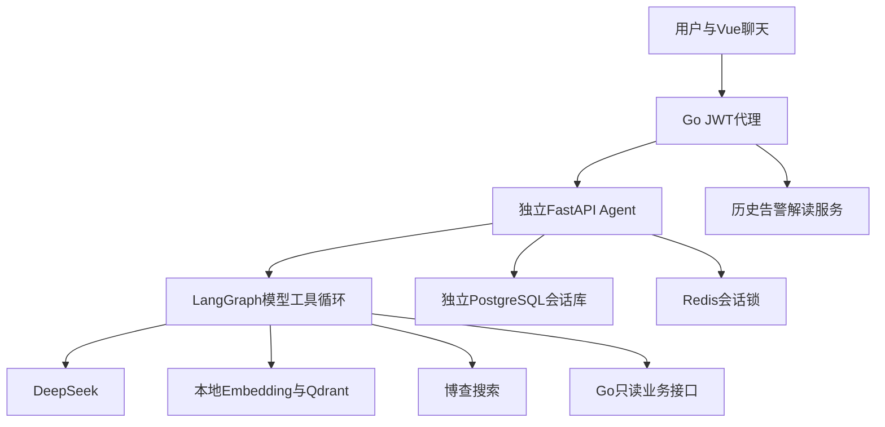

---
tags:
  - 源网智联
  - 第二版
  - Agent与RAG
status: 现行
scope: 第二版-问答
updated: 2026-10-13
---

# 01 · 技术选型与数据流

## 一、技术选择

FastAPI作为独立服务；LangGraph只编排模型/工具循环；DeepSeek兼容协议沿用已有中转主模型（hgapi.dieqiyun.top，用户明确授权），配置标识deepseek-v4.1-flash；博查独立搜索；本地multilingual-e5-small进行384维Embedding；Qdrant Cosine检索；PostgreSQL持久会话；Redis并发保护；Vue3复用平台界面。没有强制Router计划或第二个来源审核模型。

**模型接入协议（兼容式，2026-10-22 起）**：经 `hgapi.dieqiyun.top` 调用时请求统一发 `stream: true`，`provider.py` 按响应 `Content-Type` 分流——`text/event-stream` 逐帧聚合 `delta.content`，并按 `index` 合并增量 `tool_calls`（`id`/`name` 取首个非空、`arguments` 拼接），遇 `[DONE]` 结束；`application/json` 仍按 `choices[0].message` 直读，用于上游恢复非流式或切换官方通道。该网关已不再为非流式请求返回 JSON，只回一行心跳帧，所以“非流式”不再是本服务的可用选项。09 运维与 10 安全审查使用同一套兼容式解析（各自 `wire.py`、`provider.py`）。**07 告警解读走官方 `api.deepseek.com`，仍是非流式 JSON，不共用该网关与解析器**；笔记中提到“非流式”时必须指明是 07 官方通道，否则会与共用网关的智能体混淆。详见部署日志 37。

## 二、数据流

## 三、资料导入

资料清单 → 提取MD/DOCX/PDF/TXT → 标题和段落切片 → 本地E5 → 新Qdrant集合 → 计数及查询验证 → 原子切换别名。400token片段、60token重叠；query/passage前缀；旧集合保留。废案不自动入库，扫描PDF未提取文本明确记录。

## 四、选型来源

- [E5模型说明](https://huggingface.co/intfloat/multilingual-e5-small)
- [Qdrant文档](https://qdrant.tech/documentation/)
- [LangGraph文档](https://docs.langchain.com/oss/python/langgraph/overview)

## 相关笔记

[[01-项目调研规划与开发建设记录/02-第二版-智能体升级/问答及调度业务主智能体/当前方案-Agent与RAG重建/00-索引·Agent与RAG重建]] · [[02-工程规范边界与验收治理/项目工程规范/00-索引·项目工程规范]] · [[06-代码工作区导航与链接映射/stages-08-agent-rag-README|README]]
