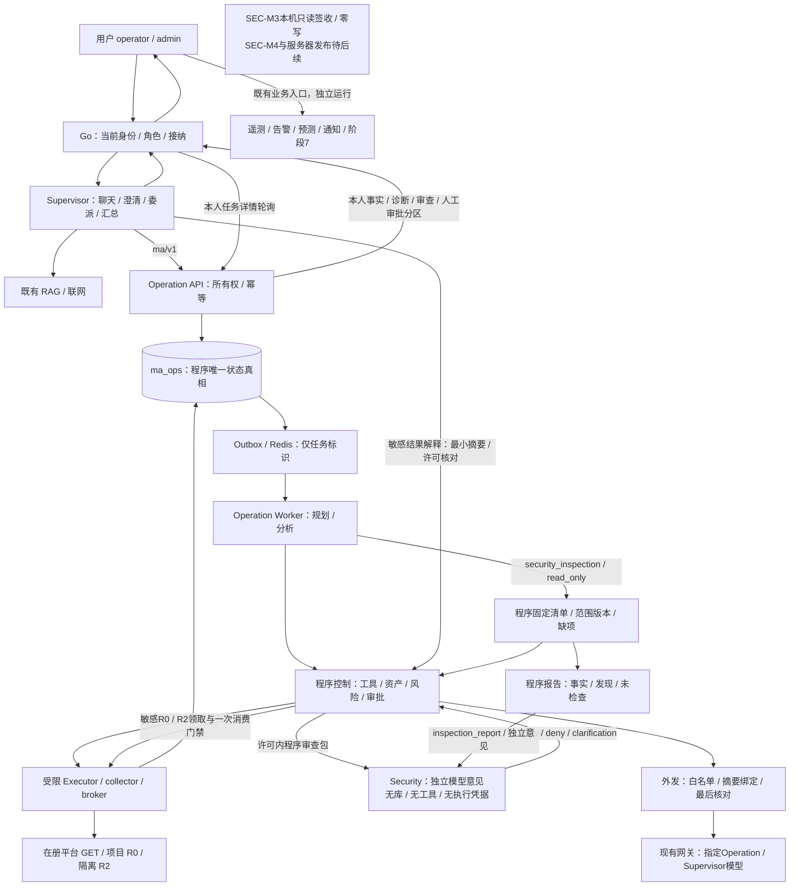
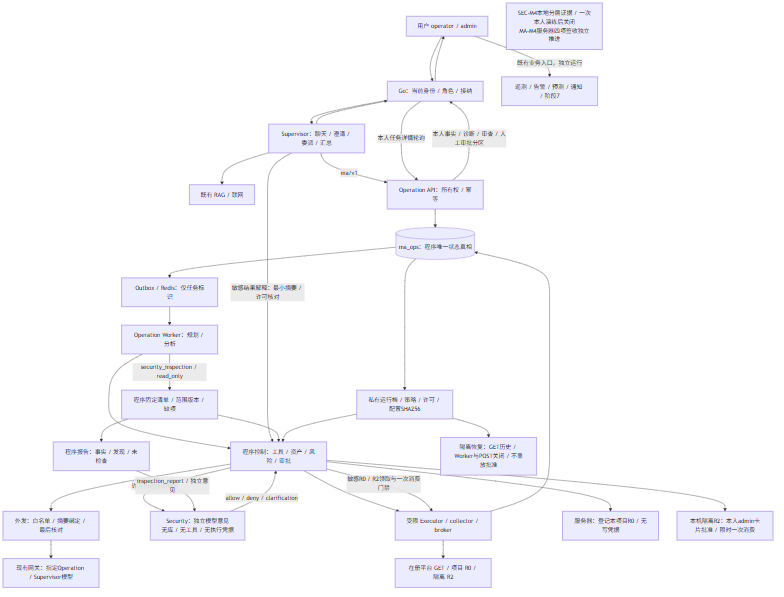
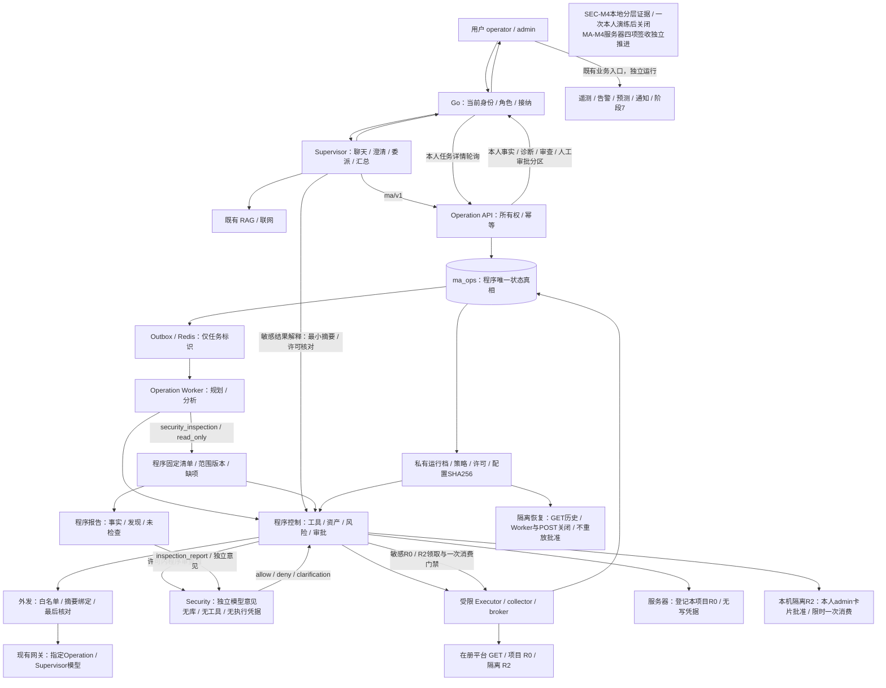

# 01 · 总体架构与智能体职责

> 2026-10-14当前：SEC-M4本机限定签收及r6追加准入通过；MA-C32～C35和最终文档门槛已完成，MA-M4及联合阶段四在声明范围正式技术签收。服务器r6/v5、恢复维护修订3；本机唯一批准动作保留，写窗口关闭，生产仅登记R0。

## 一、责任与权限

| 组件 | 责任 | 权限来源 |
| --- | --- | --- |
| Go入口 | 登录、当前角色、接纳、可信身份、本人任务代理 | 当前JWT与用户表 |
| Supervisor | 对话、目标澄清、RAG、联网、委派与汇总 | 受控聊天注册工具 |
| Operation API/Worker | 严格任务受理、独立规划、诊断 | 服务鉴权、程序风险上限 |
| Security Review（本机候选） | 敏感读取/外发审查、审批与动作前后审查；巡检已在SEC-M3本机实现 | 最小安全包，无执行凭据 |
| 程序控制/Executor | 计划校验、必要审查、审批、调度与存证 | Manifest、身份、资产、策略、一次授权 |
| 受限适配/collector/broker | 固定R0与唯一隔离R2动作 | 独立私有凭据与最小能力 |
| ma_ops / Redis | 唯一任务/审计真相 / 临时通知 | 独立账号、命名空间 |

模型不能产生可信身份、审批决定、实际执行状态或权限开关；安全allow不提升权限。任务/审查程序写库，Supervisor和Security不直接修改任务表。

## 二、总体架构

图源：[architecture.mmd](diagrams/architecture.mmd)。Security及强制门禁已接入SEC-M2本机候选；巡检已在SEC-M3本机实现，服务器发布仍待后续。现有写窗口关闭；原业务链路不等待Operation/Security。

## 三、已实现迁移与保留

Supervisor正常工具为search_knowledge、web_search、dispatch_ops_task、get_ops_task，无平台直查隐藏备用；八类平台GET排序、分页、时间与错误契约保留。固定主动核验仍程序GET、用户确认、同会话追加和零模型。

Worker通过受鉴权的阶段8知识查询获取章节事实和来源，无Qdrant管理/导入权。资料与网页不成为系统指令。阶段7自动解读、Go业务状态机和WebSocket业务广播继续独立，不将模型结果写回告警状态。

## 四、编排与部署

阶段8既有8093、阶段9标准本地8094保持；各隔离验收端口以源码README为准。API/Worker当前单进程，临时JWT留内存；后续横向扩容需另行可撤销委托设计。

LangGraph负责模型编排，数据库负责业务持久化和恢复，不以模型检查点代替任务状态。未来安全独立服务配置、预算和最小HTTP契约，复用已有栈/网关，不新增公网入口或任意Agent互聊。MA-M4延期，具体发布参照共享部署页。

## 五、契约与流程入口

程序控制层集中维护任务/状态/工具/数据/审批/审查；安全模型维护独立规则与巡检，公用架构只表达协作和依赖。完整时序见[task-sequence.mmd](diagrams/task-sequence.mmd)及程序控制任务契约，任务状态见[task-state.mmd](diagrams/task-state.mmd)。

## 2026-10-14联合阶段四交付入口

联合第四阶段统一归[[01-项目调研规划与开发建设记录/第二版-智能体升级/多智能体协作建设/06-联合发布验收/00-索引·联合发布验收]]，规划/实施/测试/问题集中维护；本地与服务器分层证据沿原SEC/MA编号保存，最终判定见[[01-项目调研规划与开发建设记录/第二版-智能体升级/多智能体协作建设/06-联合发布验收/03-联合第四阶段测试与交付]]。

## 阶段四架构图与证据边界

![[01-项目调研规划与开发建设记录/第二版-智能体升级/多智能体协作建设/02-技术选型与架构设计/diagrams/architecture.png]]

图中服务器R0、本机本人批准R2、恢复只读三个运行档分别校验；图示为实现关系，不表示MA-M4实机已通过。

## 相关笔记

- [[01-项目调研规划与开发建设记录/第二版-智能体升级/多智能体协作建设/02-技术选型与架构设计/02-共享技术选型与服务依赖]]
- [[01-项目调研规划与开发建设记录/第二版-智能体升级/多智能体协作建设/02-技术选型与架构设计/03-三智能体协作流程]]
- [[01-项目调研规划与开发建设记录/第二版-智能体升级/多智能体协作建设/03-程序控制层/00-索引·程序控制层]]
- [[01-项目调研规划与开发建设记录/第二版-智能体升级/多智能体协作建设/05-安全审查模型/00-索引·安全审查模型]]
