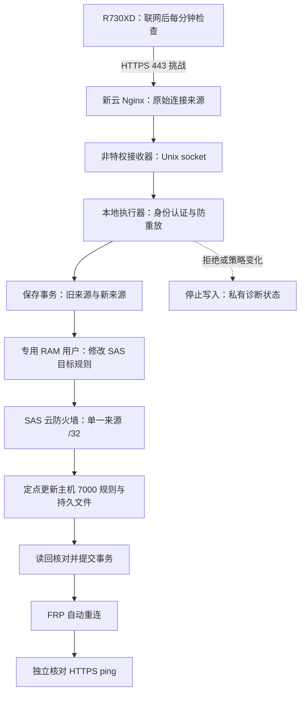
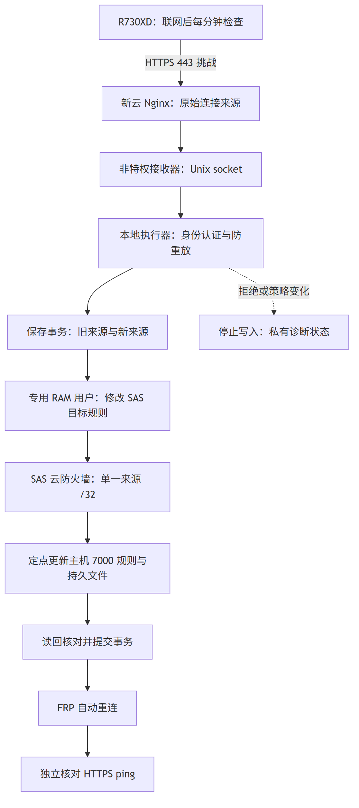

---
tags:
  - 源网智联
  - 补充业务
  - 独立云服务器部署
  - FRP
  - 自动恢复
status: 现行
scope: 补充业务
updated: 2026-10-18
---

# 01 · FRP动态出口自动维护

> 本页记录 R730XD 动态出口导致新云入口 502 的自动恢复设计、双端配置流程与交接。它是当前家庭/实验室动态公网出口环境的补充业务，属于独立云部署完成后的可选附加流程，不是通用部署主流程的必经步骤。对应 [[03-平台使用运维与二次开发手册/平台运维与二次开发手册]] 的公网入口维护；实际变更与核验结果归 [[04-系统部署发布备份与变更记录/独立云服务器部署/05-验收与变更日志]]。命令以 [[04-系统部署发布备份与变更记录/独立云服务器部署/scripts/00-脚本使用说明]] 为唯一维护入口。

> **2026-10-16 当前状态**：服务器产品为轻量应用服务器SAS，ECS前缀列表和实例角色方案已撤回。现行1.1.1使用SAS防火墙API及专用RAM程序用户；本人已完成云身份和私有凭据，真实认证及定时维护已启用。当前来源一致，真实云规则修改及公网换址恢复尚未实测，详见第六章。旧批次结论保留原范围，不代偿本次结果。

## 一、问题与目标

### 已确认的故障链

2026-10-16，新云 HTTPS 首页和 ping 返回 502，R730XD 本地及旧入口为 200。新云 frps 运行，但 R730XD 出口 IPv4 与 7000 单来源允许列表不一致；frpc 反复连接超时。人工核验并更新来源后，FRP 自动重连，业务容器无需重启。10 月 11 日也有同类维护记录。

- **断网期间**：R730XD 与新云连接中断，公网入口无法继续访问业务。
- **网络恢复后**：若出口换址，旧 `/32` 仍会阻断合法客户端，普通重连或重启无法修正白名单。
- **本次目标**：网络恢复后自动认证设备并同步来源，分别报告“白名单更新完成”和“入口已恢复”。

> API 缺少路由产生的 404 属于独立的版本回退问题。本机制不替代发布门禁，也不重建业务镜像。

### 文件归属

按 [[02-工程规范边界与验收治理/项目工程规范/01-目录边界与笔记治理#三、文件放置规则]] 的“补充业务”条款，本页正文归 `01-项目调研规划与开发建设记录/补充业务/04-FRP动态出口自动维护/`，部署目录仅保留可选流程导航；脚本及配置仍留在 `deploy/edge-server/独立云服务器部署/scripts/`、`config/`。R730XD 位于可能断线换址的公网出口后，而新云 SAS 的 7000 必须保持单一来源限制，因此才追加独立恢复通道。固定出口、专线或其他稳定连接环境应先评估是否需要，不因使用 FRP 就默认安装。第一版阶段六仅增加后续维护导航，保留 2026-09-29 正式交付事实，不将这项后续能力补写为当时已经完成。

## 二、设计原理

### 恢复通道独立于故障通道

R730XD 主动请求新云已有 HTTPS 443；Nginx 将专用路径直接交给云机 Unix socket，绕过 FRP 和 R730XD 业务 API。即使 7000 被旧来源阻断、3667 代理尚未建立，来源刷新请求仍可到达新云。

> 避免“必须先连通隧道，才能修复隧道”的循环依赖。443、证书或新云本身故障时，本机制也会等待恢复，不能替代网络和证书维护。

图源为 [Mermaid 文件](diagrams/frp-source-recovery.mmd)，白底 PNG 与本页内联图保持一致。

### 身份稳定，地址可以变化

- 使用 R730XD 专用随机设备密钥认证，而不是用不断变化的公网 IP 代表设备身份。
- 云端生成 120 秒有效的一次性挑战，签名绑定接口、设备、挑战和实际来源；挑战消费状态持久保存，重启后也不能重放已使用挑战。
- Nginx 覆盖来源头，执行器只接受登记的本地进程 UID；客户端上报的 IP、端口或资源 ID 不参与授权。
- 客户端验证 HTTPS 证书，禁用代理和重定向；身份密钥不进入接收器、命令参数或公开笔记。

> 只报告“我的新 IP 是什么”不足以授权更新。必须同时证明设备身份，并以新云看到的原始 TCP 来源为准。此方案假设 R730XD 到 443 与 7000 使用同一个公网 IPv4 出口；多出口分流需先调整路由。

### 两层白名单使用相同目标

SAS云防火墙和主机防火墙都会限制连接，仅维护其中一层会留下旧来源。云端通过`ListFirewallRules`核对当前SAS实例的全部规则，再用`ModifyFirewallRule`修改固定RuleId的SourceCidrIp；主机侧仍只替换7000的单一`/32`来源与持久文件。

- 专用RAM程序用户的写权限限定到目标防火墙规则ARN，不获得创建、删除规则或通用管理权限。
- 对该规则保持TCP、7000及备注；IAM限制的是规则身份，端口与单一`/32`约束由程序核验，不能声称IAM可限制该规则只能修改来源字段。
- `ListFirewallRules`读取授权按官方模型为本账号、本地域的`firewallrule/*`，程序只查询登记的实例。读取范围比一条规则宽，写入仍只允许目标规则。
- 7070管理来源、3667公网阻断及IPv6规则不随业务出口变化；额外覆盖7000的允许规则或非目标漂移会阻止写入。

### 事务恢复与幂等

变更前保存旧来源、新来源和非目标策略基线；先更新SAS目标规则并读回，再定点更新主机规则及持久文件，最后提交 accepted 状态并归档事务。

- **配置一致**：返回成功，不写规则、不 reload 服务。
- **云 API 超时**：保留 pending，下次先读真实状态，避免把“响应丢失”误判为“没有生效”。
- **中断在规则与文件之间**：只允许旧/新两个已登记状态，下一次认证请求继续收敛。
- **非目标变化**：停止自动写入，保留记录，人工检查合法维护或异常；不覆盖共享主机整套规则。

> 非目标策略冻结意味着合法新增容器或规则也可能暂停自动更新。应先审查变化、归档旧基线后重新初始化，不能把自动重建基线作为故障兜底。

## 三、权限与配置

### 双端职责

| 位置 | 组件 | 权限 |
| --- | --- | --- |
| R730XD | 定时客户端 | 读设备密钥、发 HTTPS |
| 新云 | Nginx 与接收器 | 转交请求、无云写权限 |
| 新云 | 本地执行器 | 固定SAS规则及主机规则 |
| 阿里云 | 专用 RAM 程序用户 | 指定规则写、区域规则读 |

脚本、unit 和无秘密模板位于 `deploy/edge-server/独立云服务器部署/scripts/`、`deploy/edge-server/独立云服务器部署/config/`；现有阶段四部署脚本与阶段六运行导航保持原归属。

### 私有文件与身份

- 两端 `/etc/powersystem-edge/source-refresh.key`：root:root 600，独立生成，不复用 FRP token 或其他口令。
- 新云 `source-refresh-cloud.json`：root:root 600，保存provider=swas、地区、SAS实例ID及目标防火墙RuleId。另一个root私有credentials文件只保存专用RAM用户AccessKey。
- R730XD `source-refresh-client.json`：root:root 600，保存开关和与云端一致的 client_id。
- 新云 `/var/lib/powersystem-source/`：root 私有的挑战、基线、accepted、pending 和历史记录；R730XD 状态在 `/var/lib/powersystem-source-client/`。

云API身份采用所有者选定的专用RAM程序用户；AccessKey只保存在新云`/etc/powersystem-edge/source-refresh-cloud-credentials.json`（root:root 600），不交给R730XD、接收器或Agent。运行程序使用ACS3-HMAC-SHA256签名，只读该固定文件，不读取环境变量、CLI profile或ECS实例角色。

> SAS支持通过RAM身份调用自己的API，不等于可以把ECS实例角色方案照搬到SAS。此前IMDSv2可访问、角色路径404的结果，不能证明服务器是ECS或需要绑定ECS角色。长期AccessKey是本次经所有者选择的凭据方式，须最小授权、私下交接和轮换。

### 前置条件

- 新云 443 能从动态公网出口访问，IP 证书和续期正常。
- 当前项目主机防火墙处于 active，既有单来源文件和规则一致。
- SAS目标7000规则、专用RAM程序用户和私有凭据完成配置，其他SAS规则无覆盖7000的放行或拒绝策略。
- SSH 公钥及云控制台应急通路保留；root 登录不等同于阿里云控制面授权。

## 四、配置流程

#### 步骤 1 · 保存基线并准备双端文件

> 通过已核验 SSH 公钥连接两台主机；准备安装不会启用任务或修改入口。具体命令见 [[04-系统部署发布备份与变更记录/独立云服务器部署/scripts/00-脚本使用说明#二、准备安装]]。

记录业务容器镜像、启动时间、重启计数、新云 Nginx 和 IPv4/IPv6 规则摘要。安装器分别使用 cloud/client 模式，只安装源码、模板、unit 和停用配置，不覆盖已有私有配置。

#### 步骤 2 · 在SAS控制台核对目标规则

> 由所有者或明确授权的操作者进入“轻量应用服务器”控制台，不进入ECS。不要创建ECS前缀列表、绑定ECS实例角色或修改其他实例。

1. 选择广州地域、指定公网IP的新云SAS实例，记录其32位实例ID。
2. 打开该实例防火墙，找到本项目TCP 7000规则；来源应为当前R730XD出口的单个`/32`，取新云root私有`allowed-client-ipv4`，不贴到聊天或仓库。
3. 使用官方OpenAPI Explorer的SWAS-OPEN 2020-06-01 `ListFirewallRules`按该InstanceId只读查询，取得对应规则的RuleId；不要调用Modify接口试改。
4. 若7000规则不存在，由所有者仅新增该单来源规则；若存在其他覆盖7000的规则，先核对协议、端口、来源及允许/拒绝策略。共享规则须确认归属与具体处置授权，不能为通过程序擅自删除。

> **禁用不等于移除。** SAS禁用规则可能形成拒绝策略。2026-10-16将“全部TCP+UDP、1–65535、所有来源”禁用后，SSH握手与HTTPS请求超时；所有者删除该条后恢复。迁移这类重叠规则时必须先保存原参数、核对独立放行与应急通路，并确认删除/替换方案；不能把全端口禁用当作无影响的整理操作。程序1.1.1遇到覆盖7000的其他放行或拒绝规则均停止，不自动启停、删除或修改这些规则。

#### 步骤 3 · 创建专用RAM程序用户并授权

> 所有者一次性操作。此前的ECS角色模板已被SAS规则模板替换，不要授予FullAccess或使用主账号AccessKey。

创建专用程序用户，建议名`powersystem-frp-source`，不给控制台登录权限；本次所有者实际使用`powersystem`（显示名称“FRP动态出口白名单”），后续维护使用该现有身份，不重复建号。使用[[06-代码工作区导航与链接映射/deploy-edge-server-独立云服务器部署-config-source-refresh-ram-policy.example.json|RAM策略模板]]替换账号ID和刚查到的目标RuleId。写权限仅为`swas-open:ModifyFirewallRule`，资源是该地域该账号的`firewallrule/目标RuleId`；只读List权限为同地域`firewallrule/*`。

用户和策略可由所有者明确授权的操作者一次性配置；提交遇到安全验证时交回本人完成，不绕过或反复提交。为该专用用户创建AccessKey，由所有者自行通过SSH安全写入新云固定credentials文件，不发给聊天、不进命令历史。根凭据文件格式及权限见脚本README。自动更新程序不会创建RAM身份、AccessKey或扩大权限。

#### 步骤 4 · 回到 SSH 完成私有配置和认证材料

> 具体字段、密钥生成及安全传输步骤见 [[04-系统部署发布备份与变更记录/独立云服务器部署/scripts/00-脚本使用说明#三、控制台完成后的激活]]。

将SAS实例ID与目标RuleId填到新云私有配置，provider为swas，核对云目标来源等于当前主机来源后开启配置，并准备新云root私有的云API凭据。生成一次专用设备密钥，使用已核验管理通道安全传到 R730XD；保持双端 client_id 一致、文件 root:root 600。密钥不通过聊天交接。

#### 步骤 5 · 初始化并接入 HTTPS 恢复路径

> 初始化只建立本套基线，不修改云规则或防火墙。检查失败先解决，不删除失败记录绕过。

核对SAS和主机来源一致、目标RuleId及所有非目标策略后，建立 baseline/accepted，启动云端执行器和接收器。将 rate 模板安装到 Nginx http 配置，在现有 IP HTTPS server 增加专用 location include；配置检查通过后 reload，保留原站点、证书和 WSS 配置。

#### 步骤 6 · 单次核对后启用定时恢复

> 不主动断开生产网络，也不重跑业务验收。

R730XD 单次执行认证刷新，分别确认白名单状态与 HTTPS ping，再启用 timer。开机后首次等待 30 秒，每次执行结束 60～65 秒后再次检查，失败等待下周期，不重叠执行。FRP 使用已有重连机制，不由客户端反复重启。

## 五、运行与回退

### 日常判断

- `allowlist_updated=true`：两层来源完成核对或更新，不等于业务已经响应。
- `entry_recovered=true`：本次可信 HTTPS ping 为 200，不代替登录、WSS 或模型质量验收。
- 网络、证书、云权限失败：保留既有来源，保存失败状态，等待后续重试。
- 非目标规则变化：暂停写入，人工核查；跨主机出现多出口分流时先修路由。

客户端失败状态、executor journal 和 root 私有事务供值班排查；本轮不新增外部消息通知或复用业务飞书凭据。只在状态和日志记录故障，通知接入需另行明确目的地。

### 定点回退

先停 R730XD timer 和在途客户端，再停新云接收器，防止自动更新与人工回退竞争。有 pending 时使用执行器定点回退，只处理登记的旧/新来源；云凭据不可用时由所有者在SAS控制台恢复目标规则。已提交事务需人工选择历史来源重新核验，不用整表恢复覆盖其他实时规则。命令及移除 Nginx include 的顺序见脚本 README。

### 轮换与保留

双端同步轮换专用密钥后重启本套 executor，使旧密钥失效；云AccessKey通过新云root私有文件轮换，不复制给R730XD。基线、历史、失败批次均保留，不把模拟故障合并为真实换址证据。

## 六、实施状态与核验记录

> 本节按实际完成情况更新。代码、模板或图纸存在不代表已经启用自动恢复；第一版阶段六与业务版本的历史签收保持不变。

**2026-10-16 · SAS适配更正**

- 产品事实：所有者确认新云为轻量应用服务器SAS。此前将ECS方案写成现行配置是实现前提判断错误；旧包和失败记录保留，但不再用于指导激活。
- 本批代码1.1.0：云端改为SWAS-OPEN 2020-06-01、ListFirewallRules/ModifyFirewallRule、固定规则ARN授权及root私有AccessKey。原认证、主机更新和事务恢复继续复用；后续增量见下。
- 1.1.0本机32项、R730XD Linux37项新增机制隔离检查通过，双端已停用升级并核对业务容器/新云规则未变。旧1.0.0的29/34项仅为历史，不代偿SAS检查；证据见[[04-系统部署发布备份与变更记录/独立云服务器部署/05-验收与变更日志]]最新SAS更正条目。
- 此批完成时步骤2～3尚待控制台配置；后续进度见下，不再要求前缀列表或实例角色。

**2026-10-16 · 控制台核对及1.1.1增量（r3-console）**

| 项目 | r3批次结束时事实（历史） |
| --- | --- |
| 产品与目标 | 控制台确认广州SAS，目标TCP7000 RuleId保持原值 |
| 云规则 | 宽范围规则由所有者删除；其余11条保留，7000改为单一`/32` |
| 来源证据 | R730XD唯一HTTPS请求的云端观察来源与主机白名单一致 |
| 私有配置 | 已填写真实SAS实例ID和RuleId，enabled仍为false |
| RAM配置 | 用户及单规则策略提交遇到安全验证，尚无成功反馈 |
| 云凭据 | 未创建AccessKey，服务器凭据文件不存在 |
| 自动运行 | executor、web和timer仍未启用 |

- 入口核对：删除冲突规则后SSH恢复，收紧7000后可信HTTPS ping200；20个生产容器与r2基线一致，无重启和OOM。此项为配置变更后的当前可用性核对，不是业务全套验收或自然换址实测。
- 代码1.1.1补充重叠拒绝规则预检，已双端停用安装且源码摘要一致；仅运行新增的1项隔离检查并通过，没有重复原32/37项套件，不能将旧套件写成新版本全套通过。
- 此批结束时待办：本人已关闭卡住的RAM页面，改用单页按用户、策略、授权顺序操作；后续完成情况见r4条目。已审查策略JSON另存新云root私有文件供复制，命令见脚本README，不重复维护命令正文。
- 证据：本机`artifacts/frp-source-20261016-r3-console/`、新云`/opt/powersystem-edge/runtime/frp-source-20261016-r3-console/`、R730XD`/opt/powersystem/runtime/frp-source-20261016-r3-console/`；截图、真实ID和来源只在私有批次，不加入公开笔记。

**2026-10-16 · 真实认证与定时维护启用（r4-ram-activation）**

| 项目 | 当前事实 |
| --- | --- |
| RAM绑定 | 本人已完成；控制台可见powersystem绑定唯一自定义策略 |
| 云凭据 | 本人隐藏输入写入，仅新云root:root 600文件保存 |
| 设备身份 | 随机专用密钥已在两端生成/安全同步并核对一致 |
| 云端读取 | 真实ListFirewallRules成功，11条规则与主机来源一致 |
| 服务与入口 | executor/web已active、enabled，独立HTTPS路径已接入 |
| 客户端 | 真实HMAC刷新成功，timer已active、enabled |

- 完成顺序：本人创建用户/策略并绑定 → 本人创建AccessKey、用隐藏输入工具写入 → 真实只读API核对 → 初始化基线并启动Unix socket服务 → Nginx检查通过后reload → R730XD真实认证刷新 → 启用timer及云端开机启动。
- 当前来源刷新返回`allowlist_updated=true`、`entry_recovered=true`、`changed=false`。两层规则原样保持，20个生产容器与r2基线一致，12个健康、8个无健康检查，重启计数均0、无OOM；业务镜像、模拟数据、旧云入口及7070管理来源保持原状。
- 此批没有重跑隔离套件或业务全套验收，没有主动断网、换址或强制写回相同规则。真实`ModifyFirewallRule`写分支与真实公网换址恢复尚未实测，待自然事件按独立批次补记；不能将本次`changed=false`记为实际换址成功。
- 自动维护已启用，正常每次执行完成后60～65秒再检查。恢复异常先看客户端状态及云端失败代码；只读成功不证明写权限已实测，按原RAM单规则策略维护，不额外授予FullAccess。
- 证据：本机`artifacts/frp-source-20261016-r4-ram-activation/`、新云`/opt/powersystem-edge/runtime/frp-source-20261016-r4-ram-activation/`、R730XD`/opt/powersystem/runtime/frp-source-20261016-r4-ram-activation/`。内含配置/Nginx前副本、真实云规则前后、初始化、认证、unit/timer和20容器核对；所有真实ID、来源及密钥均不进入公开文档。

**2026-10-18 · 自然事件验证准备（r5-prep，未实测）**

- 本批只做验证准备，不声明换址已验证。真实换址仍待自然事件发生；届时按本批手册执行、以 `r5-natural-event` 批次补记，不能把隔离测试或本次准备写成已上线。
- 新增验证资产于 `deploy/artifacts/frp-source-tests/`：`自然事件验证手册.md`（四环节口径、执行步骤、证据采集与归档）与 `verify-natural-event.py`（新云侧只读脱敏核对器，不调用写分支、不改生产）。
- 四环节口径：①SAS `ModifyFirewallRule` 写分支——读回目标规则来源等于新来源、历史 `committed=true`、无云错误码；②主机防火墙同步——7000 规则来源与 `allowed-client-ipv4`、accepted 两层一致且其他规则未变；③FRP 重连——7000/3667/7070 恢复监听、未手动重启；④HTTPS 恢复——可信 ping 200 且客户端 `entry_recovered=true`。
- 本机重跑隔离套件 `test_frp_source.py` 33 项通过（原 r2 为 32 项，多出 1 项为增量保护用例），确认工具链就绪；不重跑 Linux socket 套件（37 项已在 r4 双端通过）。
- 本批未连接服务器、未触发或模拟换址、未调用真实 `ModifyFirewallRule`。连接与执行顺序见验证手册。

**核验范围**

仅检查新增机制的签名失败、过期及重放、伪造来源、幂等、云 API 失败/超时、事务中断、非目标规则保护和 Linux Unix socket 权限。模拟适配器不会修改真实云资源或真实防火墙；真实换址恢复留待自然事件补记。

**设计参考**

- [SAS ModifyFirewallRule与单规则授权](https://help.aliyun.com/zh/simple-application-server/developer-reference/api-swas-open-2020-06-01-modifyfirewallrule)
- [SAS ListFirewallRules与读取范围](https://help.aliyun.com/zh/simple-application-server/developer-reference/api-swas-open-2020-06-01-listfirewallrules)
- [SAS身份管理](https://help.aliyun.com/zh/simple-application-server/security-compliance/)
- [原生 HTTP 调用与 ACS3 签名](https://www.alibabacloud.com/help/zh/sdk/product-overview/v3-request-structure-and-signature)

## 相关笔记

- 上游与目录：[[04-系统部署发布备份与变更记录/独立云服务器部署/00-索引·独立云服务器部署]] · [[04-系统部署发布备份与变更记录/独立云服务器部署/01-架构与前置门槛]] · [[04-系统部署发布备份与变更记录/独立云服务器部署/02-实施步骤]]
- 操作命令：[[04-系统部署发布备份与变更记录/独立云服务器部署/scripts/00-脚本使用说明]]
- 实际结果与交接：[[04-系统部署发布备份与变更记录/独立云服务器部署/05-验收与变更日志]] · [[04-系统部署发布备份与变更记录/独立云服务器部署/06-运维交接与值班清单]]
- 工程与安全：[[02-工程规范边界与验收治理/项目工程规范]] · [[02-工程规范边界与验收治理/项目边界与协作红线]]
- 历史阶段：[[01-项目调研规划与开发建设记录/第一版-平台主体/05-功能开发与阶段交付/06-公网安全与恢复能力/00-索引·开发阶段6-公网安全与恢复能力]]
