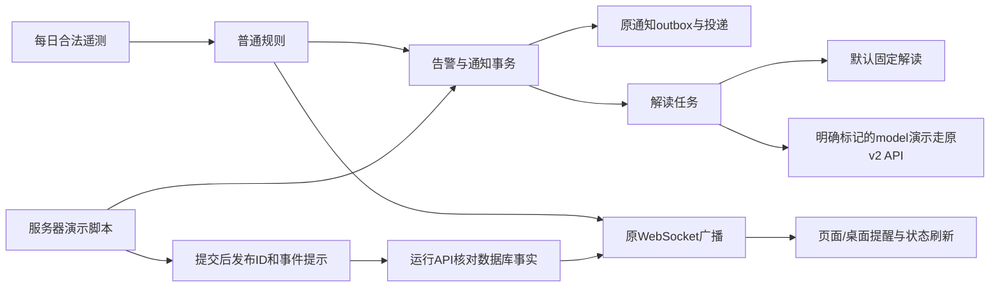

# 告警固定解读与手动演示

> 所有者要求节省常规告警token，同时保留可演示的真实API智能解读；又明确要求状态变更经真正告警通道完成。本专题维护业务与用法边界，实际是否部署只认[[00-当前系统状态]]。本批构建、部署与现场验证见[[70-固定解读与手动演示通道发布]]；前两次修复分别见[[56-遥测供数能源与历史积压接续处理]]、[[66-全设备离线复发与网关停摆复盘]]及[[67-每日告警与主动提醒链路补回]]。

## 一、两类解读

| 来源 | 解读方式 | 模型消费 | 保留能力 |
| --- | --- | --- | --- |
| 每日五时槽及其他自动告警 | 固定规则模板＋数据库事实快照 | 不进入模型HTTP、熔断或调用预占，新的固定任务model_calls为0 | 原规则、通知、告警详情与恢复照常工作 |
| 指定手动model演示 | 原官方v2模型解读 | 按原每任务最多两次预算，实际次数以任务记录为准 | 原证据采集、事实绑定、输出校验与失败原因 |
| 手动fixed演示 | 与自动告警相同的固定解读 | 0 | 用于先演示创建、状态、通知和推送，无需模型 |

常规日程按Asia/Shanghai真实时钟运行，每个窗口10分钟，按场站清单每日轮换设备，全局每日最多5条；恢复随合法遥测自然回落，错过窗口不补造。当前业务口径如下，实际部署状态以唯一状态页为准：

| 时间 | 场站 | 合法演示目标与既有规则 |
| --- | --- | --- |
| 09:00 | PV-01 | temperature 65℃ > 55℃ |
| 11:00 | PV-02 | voltage 445V > 430V |
| 13:00 | PV-03 | temperature 82℃ > 80℃ |
| 15:00 | PV-04 | temperature 65℃ > 55℃ |
| 17:00 | ST-01 | temperature 82℃ > 80℃ |

这是解读方式切换，不关闭模型配置、不影响通用助手，也不把旧AI结果改成固定回答或重置历史调用计数。页面明确显示“固定解读/未调用API”；模型演示仍显示真实模型来源。模型失败按原规则保留真实失败/预算信息，不拿模板冒充API回答。

## 二、真实通道与事实来源

- 五时槽仍由合法遥测进入原普通规则评估，形成normal告警；固定解读不代替创建告警，不改接入物理范围。
- 手动演示使用simulation来源、simulation_scenario指标及独立版本标记，复用既有设备；不伪造遥测、预测、规则越限或真实设备故障。它不占用每日五次常规额度，不改原日槽或扫描高水位。
- 告警、业务通知outbox和手动解读任务同一数据库事务提交。扫描器按alarm_id防重；重试同request-id不会重复创建或追加模型任务。
- 创建、确认、恢复仍写正常业务记录与通知；确认复用网页同一确认服务，保留指定真实账号的acked_by/acked_at。恢复只处理本脚本创建的演示，原确认、触发和解读历史保留。
- 独立CLI不能向运行API的内存WebSocket直接广播，因此本机命令提交后只向Redis传事件类型/告警ID。运行API重读并验证已提交的演示标记和当前状态，再经原广播函数推送；提示里的外部alarm body不作为事实。网页提醒、桌面通知、列表和已打开解读面板均消费原状态事件。
- WebSocket是在线提示，数据库/通知outbox才是持久事实；客户端断线时以实际状态刷新。脚本返回live_event_published/live_subscribers，不能把发布提示、静态页面或直接SQL修改当作全链路成功。

## 三、可自行演示的状态

| 目标 | 操作与结果 |
| --- | --- |
| unhandled | create创建新的未处理演示；set-state unhandled不带alarm-id也表示新建 |
| acked | 指定alarm-id和自己的既有admin/operator账号，走共同确认事务并记录身份 |
| recovered | 指定alarm-id结束演示，写恢复时间/原因，发送恢复事件；重复恢复幂等 |
| 再次演示 | 新建一条新记录与新request-id；不把旧恢复/确认时间抹掉后伪装为重新触发 |

同设备只能有一条活动演示，沿用原唯一约束；先恢复再新建，不放宽约束。确认/恢复只修改生命周期，不重新调用模型；status只读实际任务、model_calls和结果。创建前先打印request-id：终端中断或执行结果未知时，保留此键重试，不能不知结果就换键重复创建。

## 四、代码和唯一命令入口

源码脚本为stages/02-backend/scripts/demo-alarm.py，运行时通过已验active定位真实API容器，调用容器内server的demo-alarm本机命令；不嵌入密码、令牌或数据库连接串，不新增公网写接口。安装位置和完整参数命令只在[[06-代码工作区导航与链接映射/stages-04-frontend-deploy-README|部署源码README]]的“常规固定解读与服务器手动演示”维护。

请在业务VM执行，不在PVE宿主或本地电脑误执行。默认create为model演示，会调用保留API；希望先不花模型token时显式选择fixed。状态命令以脚本实际返回的alarm_id为准，页面详情路径也由真实编号生成，不固定某个演示ID。

## 五、验证与记录边界

本地真实专库/Redis/HTTP/WebSocket验证五个自动告警及监控均不调用模型，手动model走原v2请求/事实校验，fixed演示零调用；创建、确认、恢复的通知事务和实时事件连通，原五时槽/限额保留。前端覆盖来源标记、提醒/会话、空面板收到新告警及已打开面板收到恢复。原始结果与初次夹具违反活动唯一约束的失败均保留，未修改约束通过测试。

生产已用747固定、748指定API演示完成触发/解释/恢复，调用分别0/1，正常通知投递；两条只作为历史验证证据，后续请用自己创建返回的编号。具体镜像、时间及仍未覆盖的用户电脑实见范围，统一见[[70-固定解读与手动演示通道发布]]和唯一状态页，不以本页代签生产或长期稳定性。

## 相关

- [[01-项目调研规划与开发建设记录/补充业务/00-索引·补充业务]]
- [[00-当前系统状态]]
