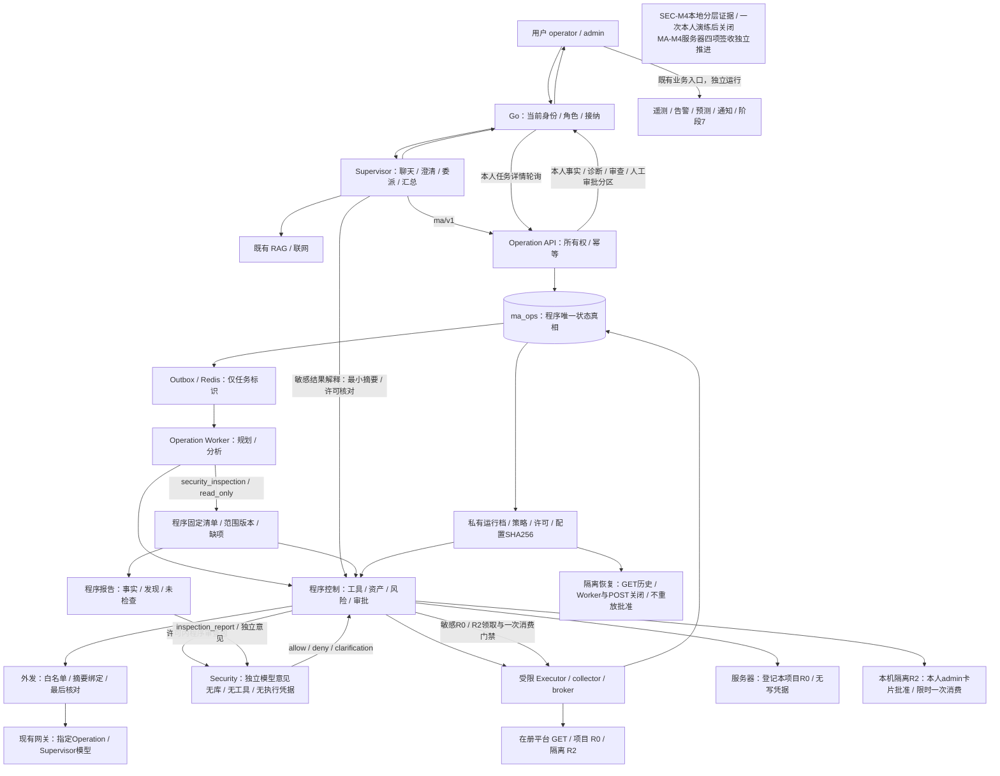

---
tags:
  - 源网智联
  - 第二版
  - 多智能体
  - 架构设计
---

# 06 · 部署、观测、备份与回退

> 2026-10-14当前：SEC-M4本机限定签收及r6追加准入通过；MA-C32～C35和最终文档门槛已完成，MA-M4及联合阶段四在声明范围正式技术签收。服务器r6/v5、恢复维护修订3；本机唯一批准动作保留，写窗口关闭，生产仅登记R0。

> 记录未来发布拓扑、指标、证据和回退门槛；对应延期MA-M4，不提供本轮执行命令。

## 一、环境与代码归属

- 阶段9源码、Dockerfile、测试及README已在MA-M1～M3实现；生产编排以独立叠加文件接入阶段4统一deploy链路，不复制一套公网Nginx/FRP。
- 本地Operation API监听127.0.0.1:8094；容器内可监听服务端口但不映射公网，只在项目网络访问。
- ma_ops逻辑库与RAG/业务库隔离，Redis使用ma:前缀；复用现有Qdrant知识接口，不新增Embedding模型或自动导入本目录。
- Supervisor与Operation独立服务凭据，执行适配层另用凭据；权限600类私有文件和只读引用，非root模型进程。
- 首期Operation单进程，不设置多个uvicorn worker；恢复限制见状态页。后续扩容需要独立委托身份设计。

## 二、开关与故障显示

OPS_ENABLED首次默认false；测试只读闭环时在限定配置开启。OPS_WRITE_ENABLED默认false且关闭不删除历史；未注册能力始终拒绝，开关不能关闭身份和资产保护。

Operation故障时聊天可以解释系统不可用，保留实际卡片状态；不偷偷恢复Supervisor直接平台读取。阶段7、原告警和通知不等待Operation。模型故障显示failed或报告降级，保留已取得工具结果，无备用模型。

## 三、观测与告警

计量任务接纳/拒绝、队列长度与最老等待、执行并发、阶段耗时、工具错误、租约丢失、outbox积压、审批过期、auth_context_lost和execution_uncertain。模型调用与工具预算按任务记录，知识查询也计入预算。

指标标签用工具类别、状态、错误码；不以用户问题、资产地址或task_id制造高基数标签。task/trace仅在私有审计关联；外部健康只返回必要状态，不暴露密钥路径和连接串。

health证明进程和配置，真实模型、GET权限及工具能力分别验收。资源异常只告警，不由模型自动改变服务器配置。

## 四、发布与实际回退

MA-M4前固定工作区文件清单、源码摘要、依赖、镜像、知识版本、策略及资产版本。保存可寻址旧镜像标签、旧源码和配套前端；预先备份。

发布流程沿用prepare/build/activate/rollback模式，适配统一部署入口。未来具体可执行命令由阶段9README维护，本页不复制历史命令当成新增服务已可部署。

回退实际恢复Supervisor、Go任务代理、前端任务字段和Operation配套镜像；停止新接纳，取消尚未开始任务，执行中取证后停止，不删除数据库、审计、向量卷或旧恢复资产。功能开关关闭不代替源码镜像实际回退。

## 五、备份与隔离恢复

新增ma_ops数据库、受控资产/策略、脱敏审计索引及私有配置引用加入既有加密备份范围；任务、审批和审计可复核计数/hash。RAG和平台备份边界继续保持。

恢复只在独立项目/数据库/Redis前缀，写工具禁用、无生产凭据，不自动执行恢复出的queued/approved任务。恢复任务标恢复副本只读，原批准记录只作证据，不作执行授权。

核对任务/步骤/调用/审批/资产版本计数、关联、报告读取、RAG历史兼容和原平台链路。不得回灌生产或清理不属本次的卷，数据库恢复不证明真实整机切换。

## 六、正式发布门槛

本机套件 → 本机真实闭环 → 指定服务器真实验收 → 实际公网页面 → 实际旧版本回退并恢复候选 → 最终加密备份隔离恢复 → 当前固定镜像30分钟观察。

观察记录持续时间、采样数、镜像/源码摘要、重启次数、错误/积压、原业务健康；每30秒采样，完整1800秒窗口。中断或更换镜像重开批次，不拼接为通过。

真实模型对基础设施摘要的外发须提前明确数据和目的地，原日志先脱敏。此次不连接服务器、调用外部模型或变更任何运行配置。

## MA-M2实际接入与撤销（2026-10-12）

本轮只安装R730XD项目专用受限采集账号、root所有固定入口/独立Python3.11环境与数据库聚合授权；17个业务容器基线未变，无新增公网端口。模型与适配均在本机回环独立进程；服务器主业务仍为原发布版本。新增对象摘要、私有映射与撤销范围由本轮安装证据及[[stages/09-ops-agent/README]]维护；撤销只允许本轮归属对象，不CASCADE业务数据或调整原账号/网络。发布/恢复/持续观察仍归MA-M4。

## 七、三Agent部署增量与延期（2026-10-13）

MA-M4延期，先完成SEC-M1～M4本机集成。未来Security独立服务、私有认证/模型配置与资源预算，仅项目内网；具体端口开发前核对，不改公网Nginx/FRP。其故障阻断对应动作，不影响原业务。

发布候选未来需同时固定安全服务、程序门禁、前后端字段、策略与许可范围。ma_ops审查记录/事件和安全私有配置引用加入既有加密备份，隔离恢复仍无生产凭据、禁写、不自动执行恢复出的审查/批准任务。

上述本机前置不取消本页原有实际回退、公网页面、最终备份隔离恢复与固定镜像30分钟观察。命令由实际源码README维护；安全服务已在SEC-M1本机构建并验证启动/停止，专库已验证通过，当前0731/v6完整闭环及常规30秒补查签收，临时例外已关闭，原型号404已解阻；尚未部署服务器。

## SEC-M2本机建设增量（2026-10-13）

本阶段不发布服务器。新本机验收PG/Redis/演练与进程按批次归属，清理回归库与正式历史分离；保留原容器、卷及SEC-M1证据。写窗口最长30分钟、每次真实重启本人审批、动作后立即关闭并实测阻断。恢复记录无身份不续跑；后续发布仍须原回退/加密备份/隔离恢复/观察门槛。

最新验收与问题：[[内容/第二版-智能体升级/多智能体协作建设/02-安全审查模型/开发阶段2-强制门禁集成/03-SEC-M2测试与交付]]。

## 2026-10-14联合阶段四交付入口

联合第四阶段统一归[[内容/第二版-智能体升级/多智能体协作建设/03-联合发布验收/00-索引·联合发布验收]]，规划/实施/测试/问题集中维护；本地与服务器分层证据沿原SEC/MA编号保存，最终判定见[[内容/第二版-智能体升级/多智能体协作建设/03-联合发布验收/03-联合第四阶段测试与交付]]。

## 阶段四架构图与证据边界

![[内容/第二版-智能体升级/多智能体协作建设/技术选型与架构设计/diagrams/architecture.png]]

图中服务器R0、本机本人批准R2、恢复只读三个运行档分别校验；图示为实现关系，不表示MA-M4实机已通过。

## 相关笔记

- 上游：[[内容/第二版-智能体升级/多智能体协作建设/00-程序控制层/05-数据库、身份权限与执行审批]]
- 现行部署：[[stages/04-frontend/deploy/README]] · [[stages/08-agent-rag/README]]
- 测试：[[内容/第二版-智能体升级/多智能体协作建设/测试资产与交付规划/02-测试资产与证据台账]]
