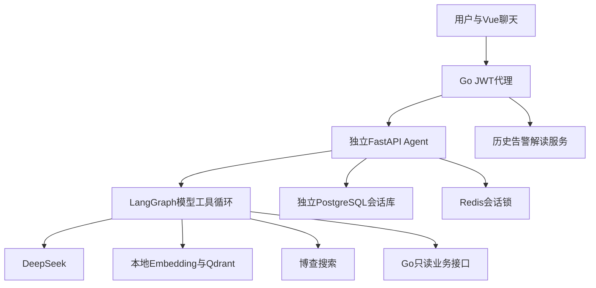

---
tags:
  - 源网智联
  - 第二版
  - Agent与RAG
---

# 01 · 技术选型与数据流

## 一、技术选择

FastAPI作为独立服务；LangGraph只编排模型/工具循环；DeepSeek兼容协议沿用已有中转主模型（hgapi.dieqiyun.top，用户明确授权），配置标识deepseek-v4.1-flash；博查独立搜索；本地multilingual-e5-small进行384维Embedding；Qdrant Cosine检索；PostgreSQL持久会话；Redis并发保护；Vue3复用平台界面。没有强制Router计划或第二个来源审核模型。

## 二、数据流

## 三、资料导入

资料清单 → 提取MD/DOCX/PDF/TXT → 标题和段落切片 → 本地E5 → 新Qdrant集合 → 计数及查询验证 → 原子切换别名。400token片段、60token重叠；query/passage前缀；旧集合保留。废案不自动入库，扫描PDF未提取文本明确记录。

## 四、选型来源

- [E5模型说明](https://huggingface.co/intfloat/multilingual-e5-small)
- [Qdrant文档](https://qdrant.tech/documentation/)
- [LangGraph文档](https://docs.langchain.com/oss/python/langgraph/overview)

## 相关笔记

[[内容/第二版-智能体升级/问答及调度业务主智能体/当前方案-Agent与RAG重建/00-索引·Agent与RAG重建]] · [[规范/项目工程规范]] · [[stages/08-agent-rag/README]]
