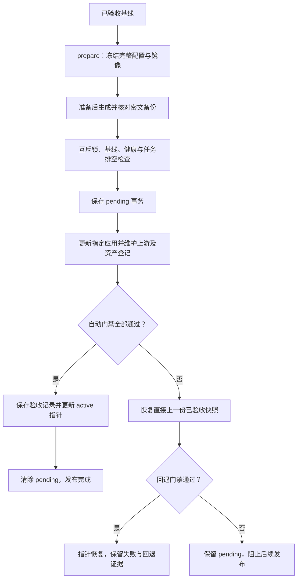

# 生产发布防回退与自动验收门禁规范

> 2026-10-16编写，供项目所有者审查。本文细化[[规范/项目工程规范#生产发布防回退与自动验收门禁（2026-10-15，强制）]]的九项总则，解释设计原理与实现边界，不另建相反规则。操作命令只在[[stages/04-frontend/deploy/README#生产发布唯一入口（2026-10-15）]]维护。
>
> 证据层：截至10月15日，工具已安装，20个生产服务的既有验收基线已登记；自动发布与自动回退分支已编写，尚未实际执行验收。本次只整理文档，没有重测、部署或操作容器。

## 一、目的与适用范围

适用于既有R730XD项目的应用镜像更新、应用配置变更和应用版本回退。首次安装、数据库演进、数据卷迁移、公开端口调整和其他主机部署应分别制定方案。

10月15日故障的触发方式是：只使用阶段4基础Compose重建API，启动了历史旧镜像，又遗漏阶段7～9的助手连接和私有挂载；API仍然healthy，ping和部分业务正常，但会话、运维任务接口404。故障经过见[[部署/部署与运维/API版本回退恢复记录-2026-10-15]]。

因此，发布版本必须同时绑定**镜像、完整编排、实际私有配置引用和验收结果**。只保存一个镜像标签或确认进程启动，不能证明原有功能完整。“防回退”防的是未声明的版本与配置倒退；受控恢复到上一份已验收版本仍是正常运维动作。

## 二、九项发布要求与工程规范的对应关系

| 编号 | 工程规范中的条款 | 必须满足的要求 | 要避免的问题 |
| --- | --- | --- | --- |
| PUB-01 | 唯一生产更新入口 | 使用`production-stack.py`管理现网应用发布、配置更新和回退，不用初装基础Compose或历史控制器直接更新现网 | 不同入口带着不同默认配置覆盖同一个项目 |
| PUB-02 | 完整编排冻结 | 按阶段4、阶段7 Agent、阶段7搜索、阶段8 RAG、阶段9多智能体顺序解析，冻结配置并确认解析往返一致 | 漏叠加文件、用错环境、相对路径或二次插值改变配置 |
| PUB-03 | 全部镜像与数据卷锁定 | 固定全部生产服务实际本地镜像ID，绑定命名卷/匿名卷，只更新指定应用，不构建/拉取或自动更新依赖 | 浮动标签变化、无关服务回退、数据卷被替换 |
| PUB-04 | 配置完整性门禁 | API保留事件Agent、RAG、Ops连接，令牌、Actor签名及聊天限额；生产R0、写关闭、审查启用、内部服务无公网端口 | 镜像正确却丢失功能配置，或维护时扩大权限 |
| PUB-05 | 候选与现网绑定 | 绑定父版本与准备时的容器状态，拒绝基线漂移、并发发布、未排空任务、无效备份和未完成事务 | 旧候选覆盖新工作，或更新截断运行任务 |
| PUB-06 | 自动验收后生效 | 镜像、环境、健康、保留服务、真实账号业务、会话/任务、匿名401与双入口WSS通过后才更新生产指针 | 用ping或healthy代替功能验收 |
| PUB-07 | 失败停止与回退 | 失败恢复上一份已验收快照并重新验收；中断/回退失败保留事务、阻止新发布 | 半完成状态被记成成功，继续修改破坏恢复依据 |
| PUB-08 | 私有产物与恢复 | 完整配置、指针与日志留在私有目录并纳入加密备份，恢复副本不自动激活生产指针或执行任务 | 泄露配置，或恢复时错误获得生产执行能力 |
| PUB-09 | 已有证据与免重测边界 | 仅首次登记既有已验收基线可沿用原证据，并核对全部容器一致；未来新发布无跳过门禁选项 | 把旧通过数或本次免重测当作永久免验收 |

PUB-01～09分别对应工程规范已有的九个加粗条目。本次保留总则原文，增加专题说明和索引，不增加第十项隐含发布条件。

## 三、设计原理

### 3.1 用不可变快照消除隐式配置

Compose叠加有顺序，环境、挂载和镜像共同决定实际运行结果。候选准备时导出最终配置为私有`compose.json`，去掉构建入口、固定镜像并保存摘要；发布时直接使用快照，不临时重新拼装基础模板。

冻结后原位改文件会使摘要校验失败，应新建候选。Compose对命令美元符号和默认字段存在规范化处理，因此必须核对冻结前后语义一致，不能只判断JSON可解析。导出配置可能包含敏感环境值，不能打印或提交Git。

镜像ID固定的是本机Docker镜像；它不等于仓库manifest digest、数字签名或跨架构迁移保证。标签仅用于准备阶段定位镜像，换机时另行核对材料。

### 3.2 用父版本和运行状态防止覆盖新工作

候选保存父版本及准备时的容器ID、镜像、启动时间和重启计数。发布前再次对照；发现服务已更新或重启，旧候选停止，由维护者判断原因后重新准备。

控制器持有排他文件锁，备份持有同一把共享锁，避免发布与备份交错。`pending.json`记录上一版本、候选、目标服务和发布前状态，使中断可追踪；它不提供后台自动恢复任务。

### 3.3 用业务契约识别“健康但缺功能”

健康检查证明进程能响应；匿名401证明路由存在且鉴权生效；登录后的会话和任务200进一步检查对应代理链。双入口业务与WSS检查覆盖反向代理、一次性ticket和长连接升级。

门禁因此结合配置检查和真实账号接口，不只是增加ping次数。使用现有私有操作员凭据，不创建账号、不伪造JWT，凭据、JWT和ticket不输出到公开日志。

### 3.4 用原子指针区分启动与验收

`active.json`只指向已验收版本，绑定清单摘要和验收记录。应用启动后仍要完成门禁；成功才替换指针，失败恢复上一份已验收快照。

**指针更新是控制面的验收确认，不是流量切换。** 当前控制器直接重建指定应用，候选在验收期间已可能对外提供服务，失败后再回退；它不提供蓝绿、灰度或零停机保证。

### 3.5 用有限回退保留数据和故障依据

回退只恢复应用配置与镜像，不回灌数据库、不降级Schema、不替换持久卷。这样可以保留期间新增的数据，但要求应用与现有数据库兼容；破坏性迁移必须另案处理。

回退也要重新验收。旧私有材料缺失或改变、回退检查失败时，保留事务并停止后续发布，不能删除标记后继续，也不能声称已经恢复。

## 四、发布流程

应用更新、Nginx或资产登记报错也进入失败处理。进程可能在任意步骤中断，下次必须先显式恢复未完成事务；没有未完成事务时，正常人工回退只恢复当前版本的直接父版本。

首次`bootstrap`是独立路径：确认原完成证据与实际容器状态一致，登记为`adopted_existing_acceptance`；不启动应用、不调用接口，也不能用它注册未经验收的新候选。

## 五、自动检查范围与实际边界

| 阶段 | 当前实现检查 | 未覆盖或需单独确认 |
| --- | --- | --- |
| 候选准备 | 五份编排顺序、服务集合、镜像可寻址、卷和端口、非目标环境、关键API/Ops配置、冻结解析一致 | 新机部署、数据迁移、全部业务功能和模型质量 |
| 发布前 | 父版本、冻结材料和私有引用摘要、容器基线、健康、互斥、任务排空、未完成事务 | 工具外root手工执行Docker不受文件锁约束 |
| 更新前备份 | 既有目录密文、SHA256一致、候选准备后且24小时内生成 | 不自动解密或隔离恢复，不能声称新备份恢复演练通过 |
| 应用更新 | 固定镜像、显式应用，禁止构建/拉取/依赖重建；必要的Nginx检查/reload、已有资产登记及同ID Executor重载 | 非蓝绿/灰度，不保证无短暂中断 |
| 发布后本机 | 全部镜像/健康/实际环境、非目标容器保持，接口检查前后状态和配置摘要再次核对 | 不扫描全部运行文件或所有主机安全配置 |
| 发布后公网 | 两入口操作员登录、核心业务、会话/任务列表及非空列表详情、匿名401、ticket和WSS101 | 空列表无对象时不查详情；不覆盖全部管理员权限或写接口 |
| 模型和长期运行 | 此门禁不主动调用模型 | 模型可用性/质量、容量、持续观察与专业适用性按变更范围另验 |

关键API配置包括`AGENT_ENABLED`、`AGENT_URL`、`AGENT_CHAT_URL`、`OPS_URL`、令牌/Actor文件引用、只读挂载和聊天限额。Ops保持`m4-server-readonly`、写关闭及审查启用；具体字段值与协议以实现为准，变更契约时同步规范。

## 六、产物与代码审查定位

| 产物或函数 | 用途 |
| --- | --- |
| `releases/<批次>/manifest.json` | 镜像、冻结文件/私有引用摘要、父版本、目标服务和准备时状态 |
| `private/compose.json` | 完整私有配置快照，不进公开仓库 |
| `active.json` / `acceptance-pointer.json` | 当前版本及各版本最近接受记录 |
| `pending.json` | 未结束事务；恢复成功前不清除 |
| 切换、验收及失败日志 | 私有证据，不直接公开原始Compose输出 |
| `origin_args()` / `freeze()` / `validate()` | 完整编排、关键配置、镜像及冻结快照准备 |
| `immutable()` / `accepted()` | 冻结材料、私有引用和已验收清单的绑定核对 |
| `prepare()` / `publish()` / `gate()` | 准备、受约束更新、验收及版本指针确认 |
| `restore_transaction()` | 失败回退及中断后的显式恢复 |

实现：[production-stack.py](../stages/04-frontend/deploy/production-stack.py)；公网门禁：[check-auth-wss.py](../部署/独立云服务器部署/scripts/check-auth-wss.py)；备份互斥与覆盖：[backup.sh](../stages/04-frontend/deploy/backup.sh)。具体操作步骤与参数只在阶段四部署README维护。

摘要用于发现变化，不是数字签名，不能抵御root同时改写文件和清单。私有引用需要原文件实际存在，当前机制不保证在密钥被覆盖或删除后自动还原旧秘密。可变资产`registry.json`由既有登记流程维护，不作为不可变秘密文件处理。

## 七、首次规范编写与证据归属（历史）

10月15日工程规范增加的是PUB-01～09对应的九项总则；部署README增加唯一操作入口，工具实现配置/镜像冻结、自动门禁和失败处理。安装及未执行范围见[[内容/补充业务/05-生产发布防回退/02-实施记录与核验边界]]。

10月16日早先的独立规范编写批次只新增设计说明及专题链接，当时未修改发布程序、未新增测试通过结论。首次沿用既有验收不等于自动发布/回退分支已实跑通过；随后当天真实前端发布的实际结果见第八章，不由这条历史范围覆盖。

业务背景与实施记录集中于 [[内容/补充业务/05-生产发布防回退/01-设计与发布流程]] 和 [[内容/补充业务/05-生产发布防回退/02-实施记录与核验边界]]；本文件仍是规范文件夹中的强制发布要求说明。

## 八、首次实际发布记录（2026-10-16）

[[部署/部署与运维/全天发电监测图表发布记录-2026-10-16]]记录前端publish与自动门禁已通过，22:10当批指针daily-generation-20261016-r3；原prod-baseline-20261015-r2保留。此前“截至10月15日尚未实跑”仅描述初次建设状态。回退函数变量遮蔽已修正，实际rollback没有触发，不能记成自动回退验收通过。

## 回答展示后续发布（2026-10-16）

[[内容/第二版-智能体升级/问答及调度业务主智能体/当前方案-Agent与RAG重建/补充阶段1-回答可读性与任务结果展示/03-测试与交付]]：2026-10-16 23:23:57 +08:00当前指针assistant-readability-20261016-r1，直接上一版本interpretation-layout-20261016-r1保留。仅前端更新，同一自动门禁通过；旧批次原日期、镜像和失败材料保持，实际rollback仍未触发。

## 相关笔记

- [[项目工程规范]]
- [[内容/补充业务/05-生产发布防回退/01-设计与发布流程]]
- [[部署/部署与运维/全天发电监测图表发布记录-2026-10-16]]

> 2026-10-16 22:37后续前端发布：[[部署/部署与运维/告警智能解读排版发布记录-2026-10-16]]通过同一自动门禁，22:37当批指针interpretation-layout-20261016-r1；第八章daily-generation为22:10首次实际发布批次，不覆盖此后指针。免重复业务测试不跳过发布门禁，实际回退仍未触发。
